# 1. Карта контекстов
## Предметная область
«Летающий мопед» — шуточное название внешнего повода для аварийной готовности. Внутри системы используется нейтральное событие тревоги. Заказчик — оператор нескольких дата-центров, дежурный запускает подготовку, инженер подтверждает задания площадки.

## Почему микросервисы
Здесь разные владельцы ресурсов и интеграций: диспетчер инцидентов, команда вычислительных мощностей, команда хранения, команда сетевого переключения и эксплуатация площадок. Резервирование обслуживает также обычные развёртывания, репликация работает постоянно, эксплуатационные задания живут часами, переключение требует узких привилегий. Их изменения и отказы должны изолироваться. Общая БД не делает атомарными внешнее переключение, репликацию и действия людей.

Монолит для учебного масштаба возможен. Мы не утверждаем математическую необходимость микросервисов: выбор оправдан предположением о нескольких площадках, независимых командах и уже существующих инфраструктурных контурах. Если этих условий нет, модульный монолит дешевле. Для задания явно принимаем эти условия и демонстрируем распределённую координацию.

## Incident Service — инциденты
Владеет тревогами, миграциями, состоянием saga, дедлайнами, журналом решений и idempotency/inbox/outbox. Уникальный активный процесс на workload исключает конкурирующие миграции. Отдельный сервис нужен для длительной координации и восстановления после перезапуска. Он решает, какой шаг нужен, но не назначает сам право записи и не владеет инфраструктурой.

## Capacity Service — резервирование
Владеет лимитами CPU/RAM, резервами и их состояниями HELD, PINNED, ALLOCATED, RELEASED, EXPIRED. Проверяет ёмкость и создаёт резерв в одной транзакции с блокировкой строки пула. Отдельный контекст позволяет использовать ресурсы и для других заказчиков, независимо от инцидентов. Только этот сервис меняет учёт доступной мощности.

## Data Protection Service — защита данных
Владеет проверками репликации и доказательствами применения checkpoint, но не бизнес-данными приложения. Адаптер обращается к внешнему контроллеру хранения. Отдельная граница изолирует специфичные для СУБД проверки timeline, checkpoint и целостности. Успех проверки связан с migrationId, generation, freezeId, source, target и checkpoint; его нельзя применить к другой миграции.

## Traffic Service — переключение
Владеет операциями freeze, promote, route и resume, их внешними operationId и наблюдаемыми результатами. Обращается к контроллеру права записи и маршрутизации. Отдельный сервис ограничивает круг компонентов, способных остановить запись или сменить писателя. Долговечный fencing обеспечивает внешний контроллер, а не значение в таблице Traffic.

## Readiness Service — готовность
Владеет заданиями персоналу, версией чек-листа и разрешением на плановое отключение конкретной площадки. Отделён из-за человеческого жизненного цикла и собственного доступа инженеров. Он самостоятельно перепроверяет доказательства у Capacity, Data и Traffic. В MVP выдаёт разрешение и показывает его оператору, физическое отключение не выполняет.

## Связи контекстов
Incident — потребитель опубликованных REST-контрактов четырёх сервисов. Все пять публикуют факты через RabbitMQ; событие ускоряет реакцию, но перед опасным действием нужна актуальная проверка владельца состояния. Capacity, Data и Traffic являются upstream-поставщиками доказательств для Readiness. Внешние API скрыты за адаптерами Data и Traffic (anti-corruption layer). Общая библиотека бизнес-моделей и доступ к чужим таблицам запрещены.

Исходник: [context-map.mmd](diagrams/context-map.mmd).
