# 2. C4 Container

Исходник: [containers.mmd](diagrams/containers.mmd). C4 представлен Mermaid flowchart: граница системы, тип и технология каждого контейнера, назначения связей и внешние системы явно подписаны.

| Контейнер | Технология для второй части | Ответственность |
|---|---|---|
| Operator UI | Простая веб-страница | Тревога, прогресс, задания |
| Incident / Capacity / Data / Traffic / Readiness | Java 21, Spring Boot, пять процессов | Контексты из карты |
| Пять сервисных БД | PostgreSQL | Только локальные ACID-транзакции |
| Event Broker | RabbitMQ, AMQP 0-9-1 | Доставка фактов, очереди потребителей |
| Identity Provider, внешний | OIDC | Токены и роли |
| Infrastructure Controller, внешний | REST API; в демо симулятор | Freeze/fence, writer epoch, promote, route, readback |
| Replication Controller, внешний | REST API; в демо тот же процесс симулятора | Применение checkpoint на B |
| Threat Feed, внешний | REST-клиент; в демо симулятор | Идентифицированная тревога |

Симулятор может совмещать два внешних API в одном процессе, но их ответственность разделена. Пользовательские данные A/B находятся за внешними контроллерами, а не в сервисных БД нашей системы. UI не является шестым бизнес-сервисом.

## Размещение и отказы
Production-допущение: API и устойчивые хранилища контура управления переживают потерю A. RabbitMQ использует три узла и quorum queues, узлы управления размещаются в независимых доменах отказа. Это целевая топология, не обещание учебного Docker Compose. Контроллер права записи тоже должен иметь независимое устойчивое состояние и исключать split brain.

В демо всё работает на одном компьютере. Проверяем падение процессов, дубли и сетевые ошибки, но не доказываем устойчивость к разрушению площадки. Сбой сервисной БД останавливает соответствующий сервис, не разрешает ему продолжать действия «из памяти».

## Нефункциональные требования
- Safety важнее доступности во время переключения: неизвестное fencing или checkpoint означает BLOCKED.
- Проектная цель демо: восстановить работу оркестратора за 30 секунд после его перезапуска; цель измеряется, не является SLA.
- Предварительный дедлайн подготовки 120 секунд, окно freeze 30 секунд, сверка каждые 5 секунд. Значения конфигурационные и требуют испытаний.
- Наблюдаемость: migrationId, commandId, generation и traceId в логах; метрики возраста outbox, отставания saga, времени без writer, DLQ и зависших резервов.
- TLS/mTLS между сервисами в целевой среде, JWT с audience и ролями. Токены не передаются через события. В демо dev-учётные записи явно отделены от production.
