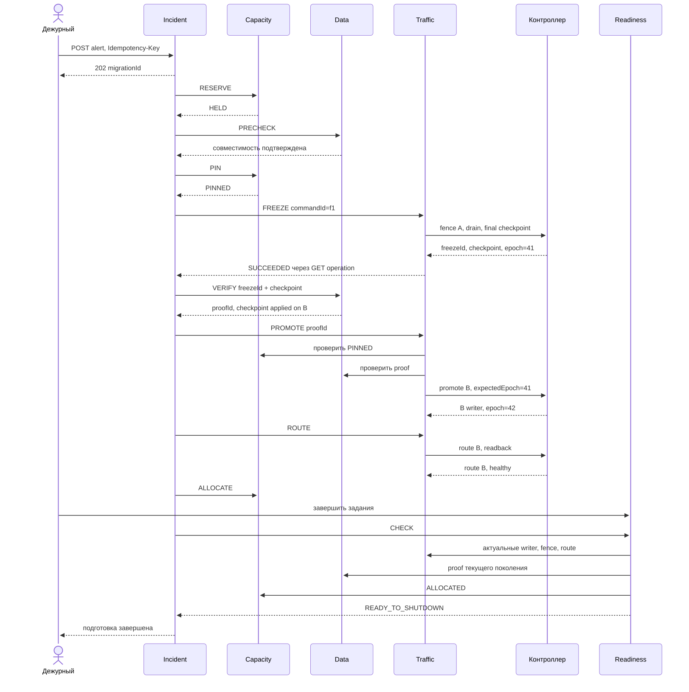
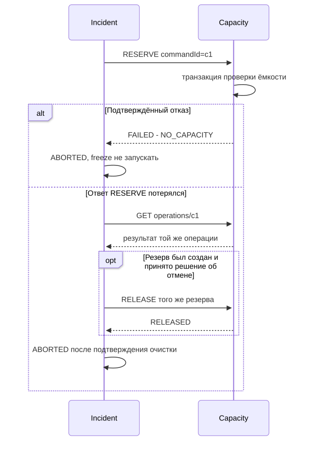
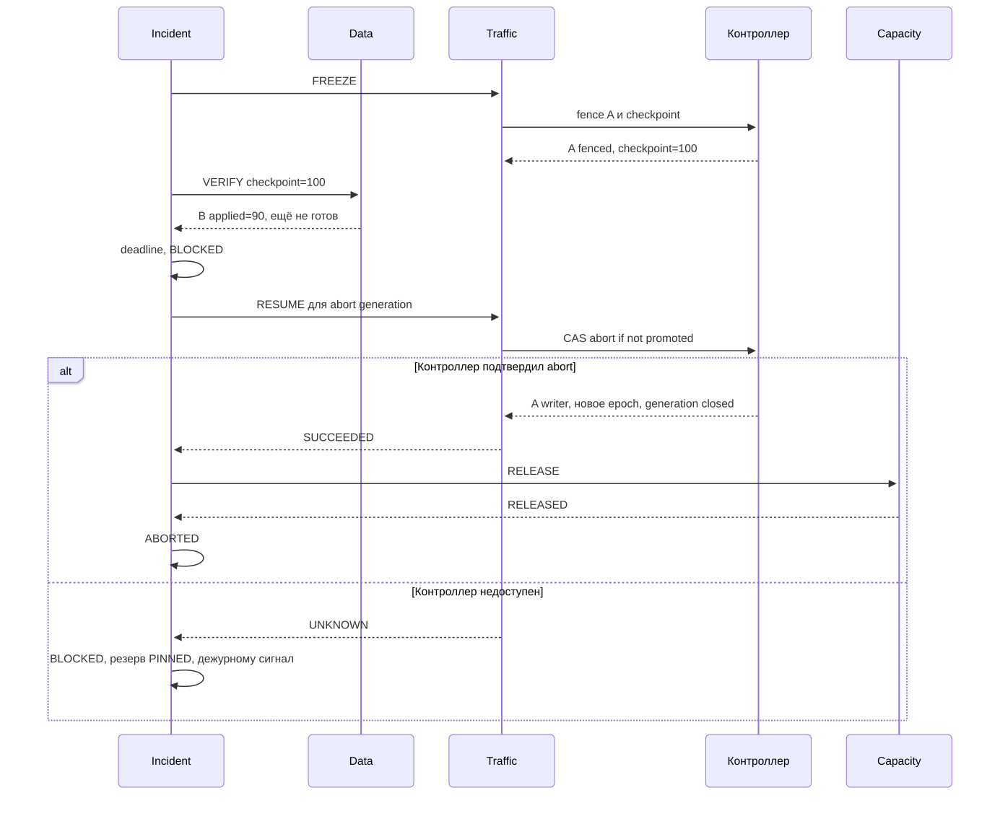
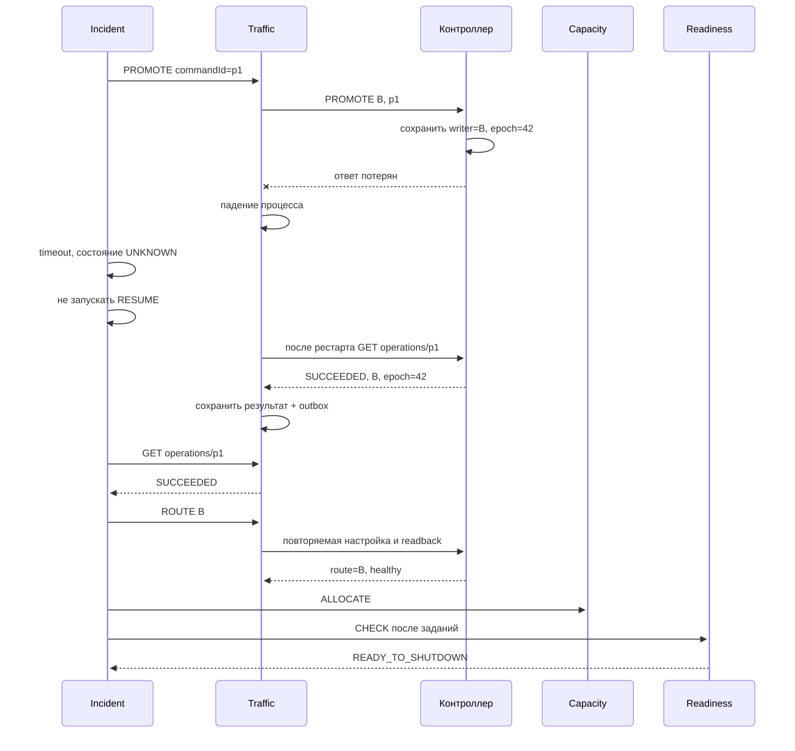

# 4. Главный процесс
Sequence-диаграммы показывают логические команды и конечные результаты. Для компактности промежуточные HTTP 202 и повторные GET operation опущены, кроме шага, где их важно показать. Фактический транспорт всех длительных операций задан в OpenAPI.

## Успех
1. Threat Feed присылает alertId. Incident атомарно создаёт миграцию и generation. Повтор alertId возвращает её; другая тревога для активного workload присоединяется к существующему процессу.
2. Capacity резервирует ресурсы HELD. Data проверяет совместимость готовой реплики. Readiness создаёт обязательные задания при событии создания миграции либо при CHECK с ленивой инициализацией.
3. Capacity переводит резерв в PINNED. После этого время само не освобождает его.
4. Traffic вызывает FREEZE: A прекращает запись, дренирует транзакции, фиксирует долговечный fence и финальный checkpoint. Если подтверждение потеряно, выполняется readback.
5. Data доказывает применение этого checkpoint на B. Проверка «lag = 0» до freeze недостаточна: между проверкой и остановкой могла пройти новая запись.
6. Traffic проверяет proof и резерв, затем PROMOTE присваивает B новое writerEpoch. Контроллер сохраняет факт перехода до возврата результата. A остаётся fenced.
7. Traffic переводит маршрут на B и делает readback/health-check. Capacity фиксирует ALLOCATED.
8. Инженер завершает задания. Readiness проверяет текущие proof, writer, маршрут, fence и резерв. Выдаёт разрешение READY_TO_SHUTDOWN. Incident фиксирует результат. Автоматического отключения в MVP нет.

## Сбой 1: мощности не выделены
Capacity подтверждает NO_CAPACITY. Freeze ещё не запускали. Incident завершает процесс ABORTED, подтверждённые частичные резервы освобождает. В MVP один резерв атомарен, поэтому частичный резерв внутри него невозможен. Если ответ Capacity потерян, Incident сначала получает исход операции по commandId, затем освобождает найденный HELD; повтор не создаёт второй резерв.

## Сбой 2: реплика не догнала checkpoint после freeze
Процесс не разрешает PROMOTE. После дедлайна Incident переводит процесс в BLOCKED, запрашивает RESUME. Контроллер атомарно закрывает попытку миграции как ABORTED и возвращает право записи A с новым epoch, только если PROMOTE не произошло. Запоздалый PROMOTE с этой generation отклоняется. Затем Capacity освобождает резерв. Если контроллер недоступен, A остаётся fenced, резерв PINNED, статус BLOCKED и вмешательство дежурного. Потеря доступности предпочтительнее двух писателей.

## Сбой 3: promote состоялся, ответ потерян, Traffic упал
B уже writer с epoch 42. Incident не знает результата и не запускает RESUME. После рестарта Traffic читает контроллер по исходному commandId, восстанавливает SUCCEEDED и outbox. Дальше повторяет ROUTE идемпотентно, резерв становится ALLOCATED, Readiness завершает проверки. Если маршрут долго недоступен, B остаётся единственным writer, система DEGRADED, отключение A ещё не разрешено. Обратный перенос — отдельная будущая миграция после синхронизации, не компенсация этой saga.

## Состояния и точка невозврата

BLOCKED сохраняет lastSafeStep и pendingCommandId; переход из него разрешён после авторитетной сверки. DEGRADED означает, что B уже writer, но маршрутизация или проверки ещё не завершены. READY_TO_SHUTDOWN — успех подготовки, не утверждение о физическом выключении A.

До promote возможна компенсация RESUME с атомарным закрытием попытки. После promote возможны повтор, сверка и завершение вперёд. Тайм-аут не доказывает, что promote не случился.

## Таблица отказов
| Что упало | Эффект | Восстановление |
|---|---|---|
| Incident | Новые шаги не запускаются | Загрузка незавершённых saga, сверка pendingCommandId |
| Capacity или его БД | Нельзя подтвердить резерв | До freeze ждём/отменяем, после freeze PINNED сохраняется |
| Data | Нельзя получить proof | Запрещаем promote, сверяем или безопасно abort |
| Traffic | Результат внешней операции неизвестен | Readback контроллера, без слепой компенсации |
| Readiness | Нет разрешения на отключение | Нагрузка на B может работать, разрешение ждёт восстановления |
| RabbitMQ | События задерживаются | Outbox накапливается, REST-сверка продолжает процесс |
| Контроллер инфраструктуры | Нет доказанного writer/fence | Новые опасные действия блокируются |
| БД конкретного сервиса | Нет локальных транзакций | Сервис fail-closed, остальные не делают выводов по кэшу |
| A до получения финального checkpoint | Нет доказательства полноты B | BLOCKED, аварийный DR вне MVP |
| B после promote | Простой приложения | A остаётся fenced; новая процедура восстановления, без автоматического возврата |

## Гарантии данных
RPO=0 относится к успешному плановому переносу при доступном A и выполненном финальном барьере. Для внезапной потери A при асинхронной репликации это неверно. Возможное расширение — синхронное подтверждение записи на независимой площадке, но оно меняет задержки и доступность. RTO не ограничен сверху при длительном отказе контроллера или отсутствии мощности.
